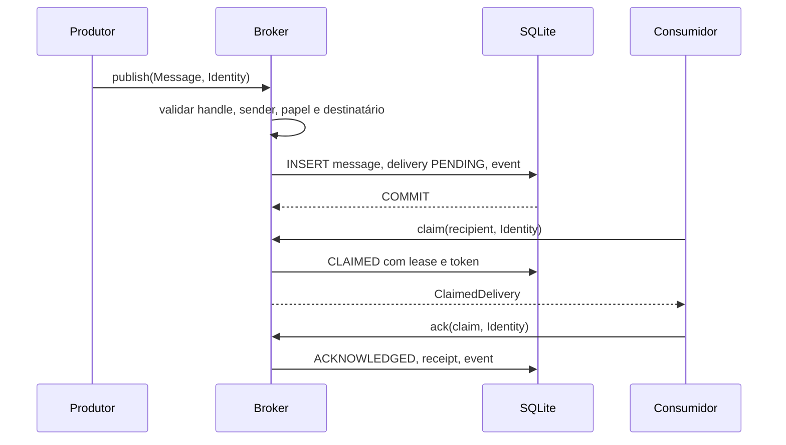

# ACP v0.1

O Agent Communication Protocol transporta mensagens entre identidades lógicas locais. Ele não conhece executores, modelos, metodologias nem estados de workflow. Um `Broker` recebe um `Message` validado, aplica a política de papéis e grava mensagem, entrega inicial e evento na mesma transação SQLite.

O envelope exige `protocol="ACP"`, `version="0.1"`, `message_id`, `run_id`, `task_id`, `sender`, `recipient`, `type`, `iteration >= 0`, `created_at` com fuso e `payload`. `correlation_id`, `causation_id`, `artifact_refs` e `metadata` são opcionais. Campos extras e mensagens acima de 64 KiB são rejeitados. `message_id` é globalmente único no banco. Uma republicação idêntica devolve a mensagem existente; conteúdo diferente com o mesmo ID causa `ConflictError` e evento `PUBLISH_CONFLICT`.

`artifact_refs` descreve `artifact_id`, `kind`, `uri`, `sha256` e `created_by`. O URI aceito tem a forma `artifact://<run>/<path>`, exige que `<run>` seja `run_id` e rejeita travessia, query e fragmento. O ACP não resolve nem abre esses caminhos. O produtor calcula o hash do conteúdo real; o broker valida o formato do hash, não a existência do arquivo. Dados de arquivo não entram no payload. Consulte [tipos de mensagens](MESSAGE_TYPES.md) e [segurança](SECURITY_MODEL.md).

A estrutura segue os limites do projeto. `communication.schemas` valida os contratos, `communication.broker` controla transições, `security` contém papéis e rotas, `persistence` contém SQLite e migração, e `simulation` exerce o protocolo. A divisão `messages.py`, `routing.py` e `repositories.py` sugerida não foi criada porque apenas duplicaria estruturas usadas por um único broker nesta fase.
