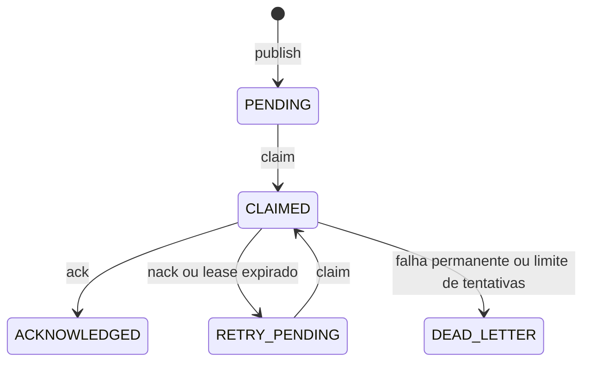

# Entrega e recuperação ACP v0.1

O broker usa SQLite como única fonte de verdade. A migração `user_version=1` cria `agents`, `messages`, `deliveries`, `processing_receipts` e `events`. `publish` grava a mensagem, a entrega `PENDING` e o evento em uma transação. `claim` usa `BEGIN IMMEDIATE`, incrementa `attempts`, cria token exclusivo e muda a entrega para `CLAIMED` com prazo de lease.

`ack` exige o token da reivindicação ativa. Uma segunda confirmação do mesmo token após `ACKNOWLEDGED` não altera o banco nem duplica recibo ou evento. Token antigo não confirma uma nova tentativa. `nack` exige motivo; `permanent=True` ou `attempts >= max_attempts` envia para `DEAD_LETTER`. O padrão é três tentativas e lease de 30 segundos. `recover_expired_deliveries()` recupera leases vencidos, e `claim` também faz essa recuperação antes de procurar uma mensagem. O erro fica em `last_error` e no histórico de eventos.

A entrega é *at-least-once*. Uma falha após um efeito externo e antes do ACK pode causar nova entrega. `processing_receipts` tem chave única `(message_id, recipient)` e impede recibos duplicados, mas não garante execução *exactly-once* de arquivos, comandos ou serviços externos. O consumidor deve usar `message_id` como chave idempotente e reconciliar o efeito externo antes do ACK. Esta versão não implementa outbox para efeitos externos nem reenvio automático de dead letters.

Mensagens e eventos permanecem no SQLite sem política de expurgo nesta versão. `get_history(run_id)` retorna envelopes em ordem de criação. Estados de entrega não representam estados da tarefa ou do workflow.
